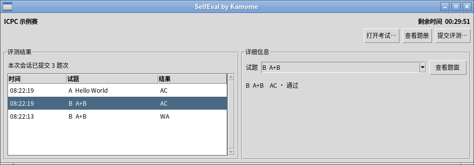
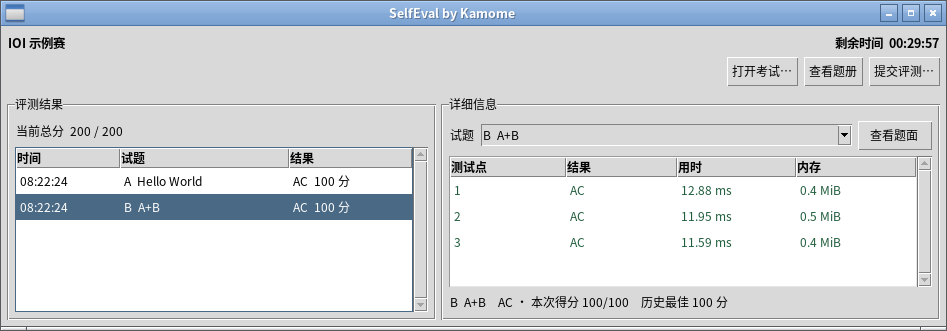
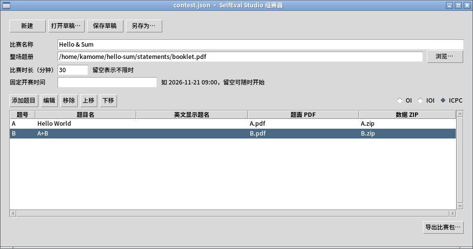

# SelfEval by Kamome

在 Linux 上制作、分发和评测单机编程比赛。**SelfEval Studio** 给组题人编辑比赛，**SelfEval** 给选手阅读题目、提交 C++ 程序和查看结果。支持 ICPC、OI 和 IOI 三种赛制。

[下载安装包与示例工程](https://github.com/ushg8877/SelfEval/releases) · [中文使用手册（PDF，8 页）](docs/manual-zh.pdf)

## 软件截图

**ICPC 选手端**　比赛倒计时和提交记录在同一个窗口。图中选手第一次提交 B 题得到 WA，修改后再次提交得到 AC。

**IOI 选手端**　选中一次提交，可以查看每个测试点的用时和内存。图中 B 题的 3 个测试点全部通过，本题得到 100 分。

**SelfEval Studio**　组题人设置赛制和时长，为每道题指定题面 PDF 和数据包，然后导出选手可以打开的 `.seexam` 文件。

## 用两道题跑通流程

1. 在 Debian 或 Ubuntu 上安装下载的 `.deb`，打开应用菜单里的 **SelfEval Studio**。
2. 解压 **SelfEval-Studio-example.zip**，用「打开草稿…」选择其中的 `hello-sum/contest.json`。
3. 点击「导出比赛包…」，保存为 `hello-sum.seexam`。用选手端打开这个文件，选择自己的代码目录，再点「开始比赛」。题目 A 使用 `a.cpp`，题目 B 使用 `b.cpp`。

从源码可以重建示例和公开版发行文件。

~~~sh
python3 examples/make_demo.py hello-sum
python3 studio.py build hello-sum/contest.json hello-sum.seexam
python3 release.py
~~~

构建产物位于 `dist/`。Debian 包将手册安装在 `/usr/share/doc/kamome-selfeval/manual-zh.pdf`，便携包内位于 `docs/manual-zh.pdf`。

## 选手

在 NOI Linux、Ubuntu 或 Debian 上，安装后从应用菜单打开 **SelfEval**，点击「打开考试…」选择收到的比赛包。之后直接启动软件会恢复上次的赛包、选手目录、所选试题和评测记录。打开赛包和选择选手目录时，选择框会按主窗口当前的大小显示。

使用便携压缩包时，也可以只为当前用户安装。安装程序会复制软件与比赛并添加应用菜单入口。

~~~sh
tar -xzf selfeval-linux.tar.gz
cd selfeval-linux
sh install.sh
~~~

便携模式可直接运行 `sh ./selfeval`。在图形桌面下打开窗口后即可关闭启动终端。在 SSH 等无图形界面的环境，直接运行会进入终端菜单。

使用「打开考试」或双击赛包时，程序会弹出目录选择窗口，默认定位到上一次选中的有效目录。选择其他赛包或选手目录后，界面显示该次练习的内容。自由开赛的比赛须点击「开始比赛」。若教师设置了固定开赛时间，准备页会显示距开赛还有多久，到点后自动开放。开赛后可查看题面并提交。有时长的比赛会显示剩余时间。

显式打开自由 ICPC 赛包后先显示准备页。上轮仍在进行时，点击「继续比赛」可接着原来的倒计时作答。从应用菜单再次启动软件时，原来正在作答的练习会直接恢复到比赛界面。上轮结束后，准备页的「开始比赛」可以开启完整的新一轮，原有答案文件可以继续使用。指定了固定开赛时间的比赛按原定时刻结束。

**OI 比赛。** 开赛后会在选手目录放入整册 `problemset.pdf`，并为每题建一个与题目英文名同名的子目录。以 CSP-J 的 `travel` 为例，打开 `travel/travel.cpp` 写代码，按题面要求读写 `travel.in` 和 `travel.out`。同一子目录中有单题题面 `travel.pdf` 和公开样例 `1.in`、`1.ans` 等。大样例可以直接打开，例如 `string/4.in`。赛中再次进入会补齐缺失的文件，保留原有代码及其他同名文件。

赛中可以选题自测公开样例，每轮结束后可查看各样例的状态、用时和内存。请在结束前保存全部代码，并保持 SelfEval 打开。倒计时结束时，程序会一次性收取选手目录中所有题目的代码，用本机正式数据评测，显示每题得分和总分。缺交或空代码计 0 分。不限时 OI 比赛可手动交卷。若程序在截止时已退出，请用原选手目录重新打开赛包，程序会收取该目录当时保存的代码；已经收取的代码会用于后续补评和查分。

**ICPC 比赛。** 勾选题号即可提交，程序会自动查找保存好的 C++ 代码。先查选手目录，优先使用 `a.cpp`、`b.cpp` 这样的题号文件，再按题名查找。根目录没有匹配时，再查以题号或题名命名的子目录。例如 A 题 *Hello World* 可以写在 `Hello World.cpp`、`A/A.cpp`、`Hello World/Hello World.cpp` 或 `Hello World/a.cpp`。题名匹配支持大小写差异，题名中的空格也可以写成下划线。支持 `.cpp`、`.cc`、`.cxx`、`.c++` 和 `.C`。提交后由本机直接评测正式数据，每题显示 AC、WA 等整体判定和必要的编译器提示。

**IOI 比赛。** 代码和题面使用与 OI 比赛相同的题目子目录。每次提交都会跑正式数据，显示测试点结果、本次得分、该题历史最佳和比赛总分。独立计分的子任务或测试点分别保留历次提交的最高分。例如两次提交各做出一个 50 分的子任务，该题计 100 分。若原题按附加点对整题扣分，或其总分舍入规则无法拆成独立的计分项，则保留整题最高分。截止时直接结算已经提交的成绩。

在提交窗口中，可以勾选一道或多道题目。评测期间显示「正在评测」，整轮结束后显示结果。

测试点的内存以 MiB 显示（1 MiB = 1024 KiB）。评测器读取 Linux 记录的选手程序峰值常驻内存；程序和运行库自身占用的页面也计入。对于同时运行多个进程的程序，评测器还会定期检查进程树的内存总量。

在终端或 SSH 中，用 `--workspace` 指定选手目录，自由开赛时用 `--start` 明确开始这场比赛。对自由 ICPC 训练，进行中再次使用 `--start` 会继续当前轮次，到期后使用同一参数可以开启新一轮。定时比赛到点即可开始。此后只需输入题号。

~~~sh
mkdir -p ~/training/hello-sum
sh ./selfeval --cli --exam hello-sum.seexam --workspace ~/training/hello-sum --start
# 在选手目录保存 a.cpp 与 b.cpp 后，一次提交两题
sh ./selfeval --cli --exam hello-sum.seexam A B
~~~

不限时 OI 比赛可在终端菜单中输入 `/finish` 交卷，也可直接执行 `./selfeval --exam practice.seexam --finish`。定时 OI 比赛将终端菜单保持打开即可自动收卷。

以下示例在 ICPC 练习赛中提交选手目录下的 `b.cpp`。

~~~sh
./selfeval --exam practice.seexam --workspace ~/training --start
./selfeval --exam practice.seexam B
~~~

开赛后也可以导出整册或单题 PDF。

~~~sh
./selfeval --exam another.seexam --pdf booklet.pdf
./selfeval --exam another.seexam B --pdf B.pdf
~~~

需要 Linux、Python 3.8 或以上、util-linux 的 prlimit 和 g++。图形窗口另需 Tk，中文显示使用系统字体。正式评测会用 python3-cryptography 读取赛包，并通过 bubblewrap 在隔离环境中编译和运行程序。桌面安装包已声明这些依赖。无 Tk 时可用终端菜单。样例自测支持选择编译器，正式评测使用本机的 `/usr/bin/g++`。常规题使用 `-std=gnu++17 -O2 -pipe`。CSP-J 2026 按原卷使用 `-O2 -std=c++14 -static`，编译器须配有静态 C/C++ 运行库。

## 组题人

通过应用菜单里的 **SelfEval Studio** 打开组赛器，也可以运行以下命令。

~~~sh
selfeval-studio
~~~

填写比赛名，选择赛制和整册 PDF。时长按分钟填写，留空表示不限时。固定开赛时间可以留空，也可以输入本机时区的日期时间（例如 `2026-12-05 09:00`），或明确写出偏移（例如 `2026-12-05 09:00+08:00`）。每题填写题号、题名，选择单题 PDF 和数据 ZIP。只有输入和输出文件时，点击「从数据目录制作…」，分别选择正式数据和公开样例目录，设置资源限制、读写方式及计分规则。用「保存草稿」保留编辑进度，用「导出比赛包…」生成给选手的 `.seexam`。

每题可另填「英文显示题名」（JSON 字段为 `english_title`），用于选手界面和终端成绩。留空时，程序沿用已有英文题名，或采用 OI、IOI 赛包中的英文文件名，例如 `travel`。仅有中文题名且没有英文文件名的旧题显示为 `Problem A` 等题号。

也可用命令行生成。文件路径相对于 JSON 所在目录。

~~~json
{"title":"校内训练","style":"oi","pdf":"problemset.pdf",
 "duration_minutes":210,"starts_at":"2026-11-21T09:00:00+08:00","problems":[
  {"id":"A","title":"旅游","basename":"travel","pdf":"A.pdf","data":"qoj/A.zip"}
]}
~~~

ICPC 比赛填写 `"style":"standard"`，IOI 比赛填写 `"style":"ioi"`。JSON 中 `duration_minutes` 为正整数，`starts_at` 须带时区。两项均可单独设置或省略。

~~~sh
./selfeval --studio build contest.json contest.seexam
~~~

## 本机正式评测与旧包转换

新版赛包可直接用于离线评测。已有使用教师口令的旧赛包时，组题人可以在终端运行以下命令，输入原赛包的教师口令，再将生成的赛包发给选手。

~~~sh
kamome-selfeval --studio enable-local old.seexam new.seexam
~~~

新版赛包将整册和单题 PDF、公开样例及正式数据加密保存，并在读取时验证完整性。直接用压缩软件打开赛包只能看到这些材料的密文。开赛后可在 SelfEval 中正常查看、导出题面和使用样例，程序会按需在本机解密，选手无需输入口令。提交的程序在 bubblewrap 中运行，只获得本次运行所需的文件。能控制选手机软件的人员也有能力读取本机解密的内容。时限以本机 CPU 计量，结果会受硬件、编译器及隔离开销影响。

本版支持标准输入输出和指定文件名的 C++ 传统题。可使用 QOJ 内置 ncmp、CSP 全文比较或夕渚镇 C 的整数检查器，并可按测试点或独立捆绑子任务计分。导入器会说明不能识别的判题配置。

界面依据所提供的 NOI SelfEval 程序中可辨识的 Qt 布局与中文控件制作。[CCF 竞赛资料](https://www.noi.cn/zxzy/lnzl/jszl/2024-08-21/829056.shtml)
